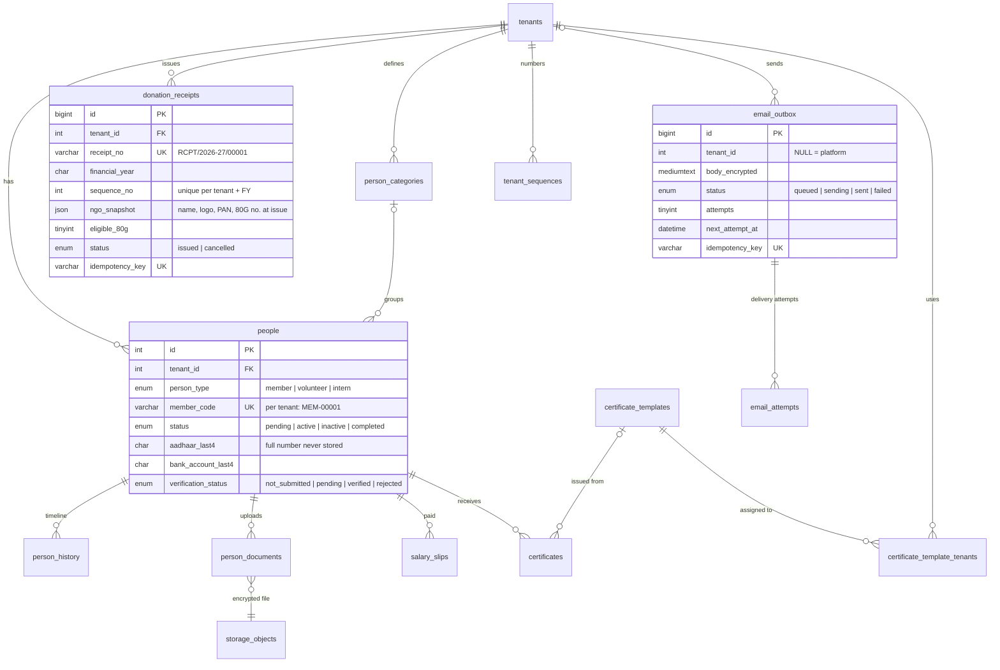

# Architecture — Fameweb NGO Cloud, Phases 1 and 2

Plain PHP 8.2+ with MySQL/MariaDB (PDO, prepared statements only), Bootstrap 5, Bootstrap Icons and Chart.js served from `public/assets/vendor`. No framework, no Composer packages, no Node.js, no background workers. Everything runs on Hostinger shared hosting.

## 1. Directory structure

```
ngo-os/
├── app/
│   ├── Core/            Framework-free kernel: Application, Router, Request, Response, View,
│   │                    Session, Csrf, Auth, TenantContext, Database, Validator, Paginator,
│   │                    Config, Env, ErrorHandler
│   ├── Middleware/      installed, guest, auth, platform, tenant, perm:x, module:x, writable
│   ├── Controllers/     AuthController, InstallController, AccountController, FileController
│   │   ├── Platform/    Fameweb admin panel (/admin)
│   │   └── Ngo/         NGO portal (/ngo)
│   ├── Services/        All business rules and every database write
│   ├── Exceptions/      DomainException (user-facing), LimitExceededException
│   ├── Helpers/         functions.php (escaping, URLs, formatting), ui.php (form/card helpers)
│   └── Views/           layouts/ (platform + 3 NGO layouts), partials/, auth/, platform/, ngo/, errors/
├── bootstrap/app.php    Autoloader, .env, config, error handler
├── config/              app, database, security, mail, modules, permissions
├── database/
│   ├── migrations/      Numbered .sql files, applied once each (tracked in `schema_migrations`)
│   └── seeds/           production.php (catalogue/settings only) and demo.php (flagged demo data)
├── routes/web.php       Every route with its middleware
├── public/              The ONLY web-served folder: index.php, .htaccess, assets/
├── storage/             logs/, sessions/, private/ (uploaded files), installed.lock — never web-served
├── bin/                 migrate.php, install.php, seed-demo.php, cron.php (CLI only)
├── tests/               run.php (PHP suite), browser/acceptance.mjs (optional Playwright walkthrough)
└── docs/                This file, DEPLOYMENT.md
```

Request flow: `public/index.php` → `bootstrap/app.php` → `Application::run()` → session start → CSRF check on every POST → route match → middleware chain → controller → service → view. Controllers stay thin: they validate input, call one service method, and render or redirect. Services own transactions, authorization re-checks, audit logging and usage metering.

## 2. Entity relationship diagram

```mermaid
erDiagram
    tenants ||--o{ tenant_settings : "has"
    tenants ||--o{ users : "employs (NGO users)"
    tenants ||--o{ roles : "owns custom + default roles"
    tenants ||--o{ subscriptions : "history of plans"
    tenants ||--o{ subscription_payments : "pays"
    tenants ||--o{ usage_records : "meters"
    tenants ||--o{ storage_objects : "stores files"
    tenants |o--o| storage_objects : "logo"
    users ||--o{ user_roles : ""
    roles ||--o{ user_roles : ""
    roles ||--o{ role_permissions : ""
    permissions ||--o{ role_permissions : ""
    users ||--o{ user_permissions : "grant / deny overrides"
    permissions ||--o{ user_permissions : ""
    users ||--o{ password_reset_tokens : "invite / reset (hashed)"
    subscription_plans ||--o{ plan_modules : "enables"
    subscription_plans ||--o{ subscriptions : ""
    subscriptions ||--o{ subscription_events : "status changes"
    subscriptions ||--o{ subscription_payments : ""

    tenants {
        int id PK
        char uuid UK "storage folder name"
        string reference_code UK "FW-NGO-00001"
        string name
        enum status "active | suspended | inactive"
        bool is_demo
    }
    users {
        int id PK
        int tenant_id FK "NULL only for Fameweb staff"
        enum user_type "platform | tenant (CHECK-constrained)"
        string email UK
        string password_hash "bcrypt / argon"
        enum status "invited | active | inactive"
        int session_version "bump = sign out everywhere"
    }
    roles {
        int id PK
        int tenant_id FK "NULL = platform role"
        enum scope "platform | tenant"
        string slug "unique per tenant"
        bool is_locked
    }
    permissions {
        int id PK
        string perm_key UK
        enum scope "platform | tenant"
        string module
    }
    user_permissions {
        int user_id PK
        int permission_id PK
        enum effect "grant | deny"
    }
    subscription_plans {
        int id PK
        decimal monthly_price
        decimal annual_price
        int max_users "NULL = unlimited"
        int max_members
        int max_storage_mb
        string gateway_plan_id_monthly "Razorpay-ready"
    }
    subscriptions {
        bigint id PK
        int tenant_id FK
        int plan_id FK
        enum status "trial | active | past_due | expired | suspended | cancelled"
        bool is_current
        int current_tenant_id UK "generated: one current row per NGO"
        date end_date
    }
    subscription_payments {
        bigint id PK
        decimal amount
        enum status "pending | paid | failed | refunded"
        string idempotency_key UK
        string gateway_payment_id "Razorpay-ready"
    }
    usage_records {
        bigint id PK
        int tenant_id FK
        string metric
        string idempotency_key "UNIQUE with tenant_id"
    }
    storage_objects {
        bigint id PK
        char uuid UK
        int tenant_id FK
        bigint size_bytes
        datetime deleted_at
    }
    audit_logs {
        bigint id PK
        int tenant_id "no FK: survives tenant changes"
        int actor_user_id
        string action
        json metadata "sanitised"
        char prev_hash
        char row_hash "SHA-256 chain"
    }
    password_reset_tokens {
        bigint id PK
        int user_id FK
        enum purpose "reset | invite"
        char token_hash UK "SHA-256, raw token never stored"
        datetime used_at
    }
```



Standalone tables: `login_attempts` (throttling), `system_settings` (key/value platform settings), `schema_migrations` (applied migration files).

## 3. Authentication

* Passwords: `password_hash()` (PASSWORD_DEFAULT), rehashed on login when the algorithm changes. Policy: at least 10 characters, a letter and a digit, not a common password, not containing the email name, max 72 bytes.
* No default or hardcoded administrator. The first Fameweb Super Admin is created by the installer, which requires the one-time `INSTALL_TOKEN` from `.env`, refuses to run once `storage/installed.lock` exists or any platform user exists, and returns 404 afterwards.
* New users never receive a password by email. They get a single-use link (64 hex chars; only its SHA-256 is stored; consumed atomically; issuing a new link revokes older ones; 72 h for invites, 60 min for resets).
* Sessions: files in `storage/sessions`, HttpOnly, SameSite=Lax, Secure on HTTPS, strict mode. The id is regenerated at sign-in and sign-out. Idle timeout 30 min and absolute timeout 12 h (configurable).
* The session holds only `uid`, `session_version` and sign-in time. Every request re-reads the user from the database and rejects the session if the user is inactive, the version changed (password change, deactivation, NGO suspension, email change) or the NGO is not active.
* Fameweb support access (`SupportAccessService`). A Fameweb admin with `tenants.users.reset` can issue an NGO user a single-use reset link or set a random temporary password (shown once, never emailed or logged) that sets `users.must_change_password`; `AuthMiddleware` then allows only `/account` until the password is changed. With `tenants.impersonate` an admin can start a support session as the NGO's active Super Admin: the session switches to that user (no password involved) and keeps the admin's id and session version under `_impersonator`. `AuthMiddleware` ends it after 60 minutes, or when the admin is deactivated, signs out elsewhere or loses the permission; sign-out ends it too, and "Return to Fameweb" restores the admin's session. Start and end are audited with the NGO's tenant id and the admin as actor, and every action in between carries `support_session_by` in its audit metadata. The NGO user's own profile and password cannot be changed from a support session.
* Throttling (database-backed, works on shared hosting): 5 failures per email or 30 per IP within 15 minutes lock sign-in. Password-reset requests are rate-limited, and the response never reveals whether an account exists.
* CSRF: a synchroniser token on every POST (419 on mismatch). Security headers: strict CSP (`script-src 'self'`, no inline scripts), X-Frame-Options DENY, nosniff, Referrer-Policy, HSTS on HTTPS, `no-store` on pages.

## 4. Authorization (deny by default)

* Every route declares its required permission (`perm:x`). A route without a matching permission is refused, and hidden buttons are never relied on. Controllers re-check object ownership, and services re-check anti-escalation rules.
* Effective permissions = (role permissions ∪ user grants) − user denies. The result is filtered by scope (platform permissions can only ever apply to `user_type = platform`, tenant permissions only to NGO users) and by the modules enabled on the NGO's current plan.
* Fameweb vs NGO is decided only from `users.user_type` and `users.tenant_id` in the database, which a CHECK constraint keeps consistent. No request field, URL or session value can raise a user to Fameweb admin.
* Anti-escalation rules:
  * A user can only assign a role whose permissions are a subset of their own. Only an NGO Super Admin can create another NGO Super Admin.
  * A user can only grant or deny permissions they hold.
  * A user cannot change their own role or permissions.
  * A user can manage a user only when the target's permissions are a subset of theirs.
  * The last active NGO Super Admin cannot be demoted or deactivated.
  * Locked roles cannot be edited.

## 5. Tenant isolation

* The tenant is resolved only by `TenantMiddleware`, from the signed-in user's database record, and stored in `TenantContext`. Any `tenant_id` in a form, query string or URL is ignored.
* Every tenant-owned query includes `tenant_id = TenantContext::id()`. Lookups by id use `findInTenant()`-style helpers, which return 404 (not 403) for another NGO's ids, so ids cannot be probed.
* Files live in `storage/private/tenants/{tenant-uuid}/…` outside the web root. They are streamed by `FileController` only after checking the requester's tenant (or platform permission), and are validated with finfo + getimagesize.
* `tests/run.php` attacks this from NGO Alpha against NGO Beta: users, roles, edit forms, status changes, files, role assignment, organization settings, search and audit log.

## 6. Subscriptions, limits and usage

* Changing a plan inserts a new `subscriptions` row and closes the previous one (`is_current = 0`, `ended_at`, `end_reason`). History is never overwritten. A generated column with a unique index guarantees exactly one current subscription per NGO. Status changes are also written to `subscription_events`.
* Status refresh is lazy (on read) plus an optional daily cron:
  * A trial past its end date becomes expired.
  * An active subscription past its end date becomes past_due during the grace period, then expired.
* Trial, active and past_due are writable. Expired, suspended and cancelled make the NGO workspace read-only (`writable` middleware), and data is kept.
* Manual payments use an idempotency key from a per-form nonce, so double submits record once. A paid payment with a period can renew the subscription. `gateway`, `gateway_order_id`, `gateway_payment_id` and `gateway_plan_id_*` are reserved for Razorpay.
* Limits are enforced in services, not views. User creation locks the tenant row (`SELECT … FOR UPDATE`) so parallel requests cannot pass the limit together. Usage is computed from real rows (users = active + invited; storage = sum of live file sizes). Metered events (`usage_records`) are idempotent via `UNIQUE(tenant_id, idempotency_key)`.

## 7. Audit log

Append-only `audit_logs`. Each row stores `prev_hash` and `row_hash = SHA-256(prev_hash + fields)`, so any edit or deletion done outside the app is detected by **Audit log → Verify integrity**. Metadata is sanitised before storage: keys such as password, token, secret, otp, aadhaar, card, api_key and hash are redacted, and 12-digit Aadhaar-like numbers are masked to the last 4 digits. Logged events include:

* sign-in, failure, lockout and sign-out
* access denied
* NGO, user, role and permission changes
* subscription and payment events
* settings changes and exports

## 8. Errors and logging

`APP_DEBUG=false` in production: users see a friendly page with a reference id, and the details go to `storage/logs/app-YYYY-MM.log`. Database errors, paths, SQL and stack traces never reach the browser. Logs never contain passwords, tokens or full Aadhaar numbers.

## 9. Adding modules

Modules are declared in `config/modules.php`. Plans enable modules through `plan_modules`. Permissions map to modules in `config/permissions.php` (a list means "any of these modules"), and the `module:x` middleware (`module:a|b` for either) hides and blocks a module that is not on the NGO's plan. Adding a module means:

1. A new migration file.
2. Permissions in the catalogue (`php bin/migrate.php` syncs them).
3. A controller group under `/ngo/<module>` with `module:<key>`.
4. A usage metric in `UsageService::METRICS` if it is limited.

Still to build:

| Module | Planned design |
|---|---|
| WordPress sync | Per-NGO connection record (site URL plus an application password, encrypted with `Crypto`/APP_KEY). Pull registrations into `people` (status pending) by user action or cron in small batches, with idempotency keys per remote id. |
| Razorpay | Fill the reserved gateway columns. A webhook endpoint verifies the signature and records payments through `SubscriptionService::recordPayment()` with the Razorpay payment id as the idempotency key. |

## 10. Phase 2 modules

Migration `002_phase2_modules.sql` adds 12 tables. Every tenant-owned row has `tenant_id`, and every lookup goes through a `find($tenantId, $id)` helper that returns null (404) for other NGOs.



**Numbering.** `tenant_sequences (tenant_id, seq_key, next_value)` is incremented with `SELECT … FOR UPDATE` inside the same transaction as the insert, so member IDs, slip numbers, certificate numbers and receipt numbers (keyed per financial year) are gap-free under concurrency, and unique indexes back them up.

**Aadhaar and other identifiers.** The form accepts the 12-digit number only to validate its Verhoeff check digit; only the last 4 digits are stored (`aadhaar_last4`). The card image is an identity document. Bank account numbers keep the last 4 digits too. `Controller::failValidation()` never flashes `aadhaar*`, `bank_account*`, password or token fields back into the session. Audit metadata masks 12-digit numbers. Donor identification for 80G receipts uses PAN or other IDs; Aadhaar is deliberately not offered.

**Encryption at rest.** `App\Support\Crypto` uses libsodium secretbox (or AES-256-GCM via OpenSSL) with a key derived from `APP_KEY`. It encrypts identity documents and member photos (`*.enc` files under `storage/private`), SMTP passwords and queued email bodies. Without APP_KEY, uploads of identity documents and saving SMTP passwords are refused (photos are then stored unencrypted) with a clear message; losing APP_KEY makes those files unreadable, so it must be backed up.

**PDF generation.** `App\Pdf\PdfDocument` is a dependency-free PDF 1.4 writer: the 14 standard fonts (WinAnsi, width tables in `FontMetrics`), text boxes with wrapping and alignment, lines, rectangles and JPEG images (PNG/WebP/GIF converted with GD), compressed with zlib when available. `SalarySlipPdf`, `IdCardPdf`, `CertificatePdf` and `ReceiptPdf` build on it, with the shared letterhead in `Branding`. PDFs are generated on download from stored data, so nothing is cached on disk. Non-Latin text (e.g. Devanagari) is not supported by the standard fonts and is replaced; ₹ prints as "Rs.".

**Certificates.** A template's layout is JSON (page background and frame plus up to 40 positioned elements in millimetres: text with `{{placeholders}}`, NGO logo, line, filled box). `CertificateTemplateService::normalize()` validates and clamps every value on save. The builder (`public/assets/js/certificate-builder.js`, no inline script) renders the same JSON as HTML for the live preview. Templates are visible to an NGO only through `certificate_template_tenants` and only while active; issuing snapshots the layout and the values so later template edits never change issued certificates.

**80G receipts.** Settings live in `tenant_settings` (`r80g_*`). Issuing requires PAN, 80G registration number and signatory, snapshots the NGO details, assigns the next number for the donation's financial year (April–March) and is idempotent per form render. Cash above the configurable limit (Rs. 2,000, section 80G(5D)) and donations in kind are stored with `eligible_80g = 0` and the PDF says so. Receipts are never edited; cancelling keeps the number and marks the PDF CANCELLED. `form10bdRows()` produces the annual statement data for eligible, non-cancelled receipts. The wording is editable per NGO and the UI states that the software does not certify legal validity.

**Email.** `Mailer::send()` (Phase 1 signature) now queues into `email_outbox` and attempts delivery at once through `EmailService::deliver()`, which claims the row (`status = sending`, `locked_until`) so cron and web requests never double-send. Every attempt is stored in `email_attempts` with the server reply (credentials are never included). Temporary failures are retried after 2, 10, 60 and 360 minutes up to `max_attempts` (5); 5xx replies other than authentication failures are permanent. After delivery the stored body is replaced by a redacted copy (64-hex single-use tokens become "[single-use link hidden]"), and `scrubOld()` does the same for older rows. Transports: `log` (development), `mail` (PHP mail()) and `smtp` (`App\Mail\SmtpTransport`, SSL or STARTTLS with certificate verification, AUTH LOGIN/PLAIN). `MailSettings` picks the platform settings (Admin > Email, falling back to `.env`) or, when the NGO has the module and switched it on, the NGO's own SMTP server. Attachments (receipts, certificates) are stored as references and regenerated at send time. Sent emails are metered in the `emails` usage metric.

**Permissions.** New tenant permissions: `people.*`, `salary.*`, `certificates.*`, `receipts.*`, `emails.*`; platform: `certificate_templates.view|manage`, `platform.email.view|manage`. Each is mapped to its module, so switching a module off on the plan removes the permissions and the routes at once.
